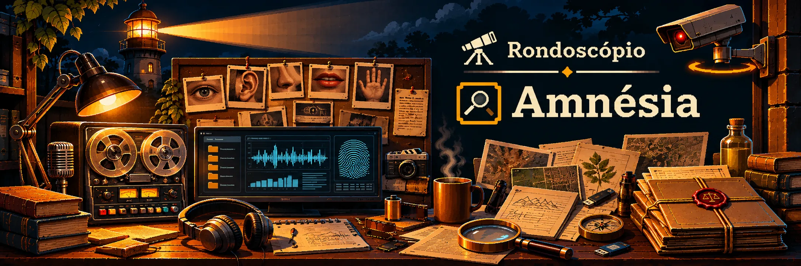

# Amnésia

Projeto do **Rondoscópio** no repositório **Rondoscopio/amnesia**.

A Amnésia é o sistema de coleta e monitoramento multimodal do Rondoscópio, proposto para acompanhar fontes públicas, captar textos, áudios, vídeos e dados estruturados, catalogar e preservar documentos, atas, publicações e outros registros de interesse público. Cada coleta deverá guardar a fonte, as datas disponíveis, o momento da captura e informações para verificar sua integridade.

## Acervo e acesso

O armazenamento será criptografado, inclusive para registros públicos. A arquitetura proposta prevê criptografia autenticada, chaves individuais por registro, proteção das chaves por encapsulamento e possibilidade de rotação. O acesso terá três níveis: público, privado e confidencial. O nível confidencial exigirá autorização específica e liberação por dispositivo criptográfico físico, além do login.

A prioridade é preservar o histórico e restringir o acesso quando necessário, em vez de excluir registros por conveniência. Evidências de possíveis ilícitos receberão tratamento restrito quando cabível. A retenção e a divulgação considerarão o interesse público, a proteção de dados e as obrigações legais. O exercício de função pública amplia o escrutínio dos atos oficiais, sem eliminar a privacidade individual.

## Diretrizes de captura e memória documental

A Amnésia deverá preservar o material original e seus metadados de proveniência, inclusive detalhes da conexão HTTP e TLS, certificados do servidor e registros de integridade, quando tecnicamente disponíveis. Capturas e derivados multimodais deverão permanecer rastreáveis e separados das interpretações investigativas. O valor histórico de um registro pode surgir muitos anos depois de sua coleta.

As propostas e os limites probatórios estão detalhados em [Captura, proveniência e preservação de evidências](docs/captura-proveniencia-e-preservacao.md). A interpretação temporal e a investigação das relações cabem ao [Córtex](https://github.com/Rondoscopio/cortex/blob/main/docs/analise-temporal-e-interpretacao.md).

Projeto em planejamento.

## License

**SPDX-License-Identifier:** `AGPL-3.0-or-later`

This project is Free Software: You can use, study, share and improve it at your
will. Specifically, you can redistribute and/or modify it under the terms of the
[GNU Affero General Public License](https://www.gnu.org/licenses/agpl-3.0.html) as
published by the Free Software Foundation, either version 3 of the License, or
(at your option) any later version.

---
